# Todo4Me

**Todo4Me** is your personal productivity dashboard: tasks with priorities and due dates, weekly planning (also as a calendar with time blocks),
weekly notes, reminders, and a document editor with PDF export. Everything runs **offline on your computer**, with no account and no cloud.
There is a Windows desktop app (Electron) and a browser version.


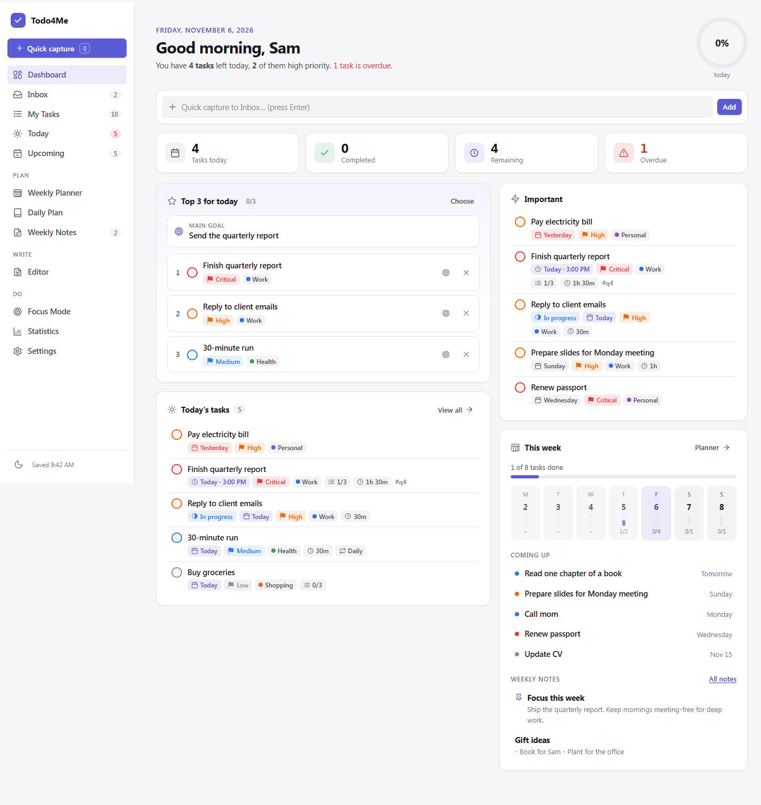

## Download & install

1. On the **[latest release](https://github.com/muelgerhbf/todo4me/releases/latest)** page (currently [2.1.2](https://github.com/muelgerhbf/todo4me/releases/tag/windows-v2.1.2)), download one of these files under *Assets*:
   - **`Todo4Me-Setup-2.1.2.exe`**: the installer (recommended). Double-click it and follow the steps. No admin rights needed; it creates a desktop shortcut and a Start menu entry. The installed version **updates itself automatically**.
   - **`Todo4Me-2.1.2-portable.exe`**: runs without installation, e.g. from a USB stick. It does **not** update itself.
2. **Windows SmartScreen:** The files are not digitally signed (a code-signing certificate costs money). If you see "Windows protected your PC",
   choose **More info → Run anyway**.
3. **Your data** is stored on your computer in the folder `%APPDATA%\Todo4Me` (e.g. `C:\Users\<Name>\AppData\Roaming\Todo4Me`); the installed and portable versions share it.
   Updates, reinstalling and uninstalling do not delete it. The app itself does not load any content from the internet (only the update check and, if you set them up, subscribed calendars).

You can also use Todo4Me in the browser without installing anything (see [Using it in the browser](#using-it-in-the-browser)).

## Getting started

1. **Try it with sample data (optional).** *Settings → Data & backup → Add sample data* fills the app with example tasks. Clean up later with *Reset all data*.
2. **Create your first task.** In the dashboard or under *My Tasks*, type into the "Add a task…" field and press Enter, or press `N` for the detailed form. With the **quick-add syntax** you set priority, category and date right away:
   `Send invoice !2 #work @fri` (priority 2, category Work, due Friday). Add `every monday` and the task repeats. To drop in a thought without details, press `Q` (*Quick capture*) to put it in the **Inbox** and sort it later.

   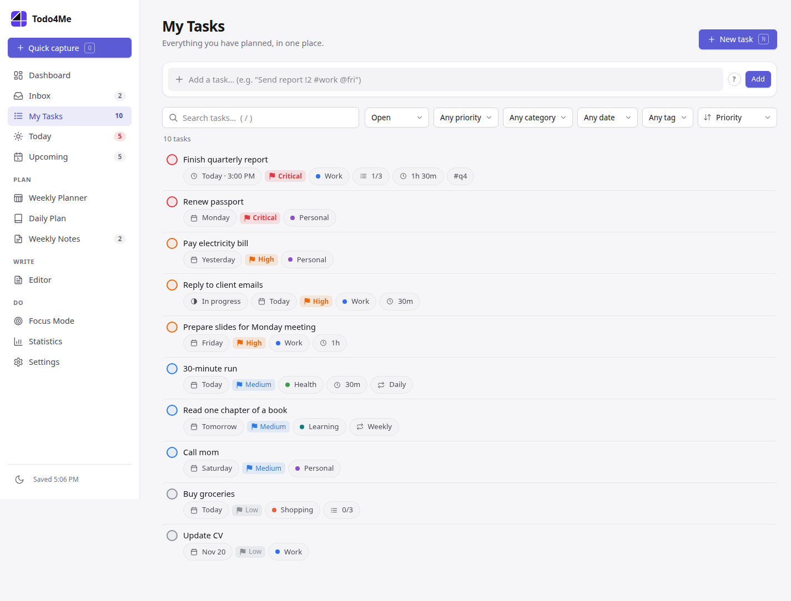

3. **Flesh out a task.** Clicking a task opens the editor: priority, due date and optional time, estimate, category, tags, subtasks, repeat and **Reminder**. *Today* shows what is due today, *Upcoming* the next 14 days.
4. **Focus on your day.** The dashboard shows your daily overview. With **Choose** you pick your **top 3 for today**; *Focus Mode* (`G` then `F`) hides everything except one task and comes with a Pomodoro timer.
5. **Plan the week.** In the *Weekly Planner* you drag tasks between days (**Days**). The **Calendar** view shows an hourly grid: tasks with a time are blocks that you can move, resize by dragging, or create by clicking an empty slot.

   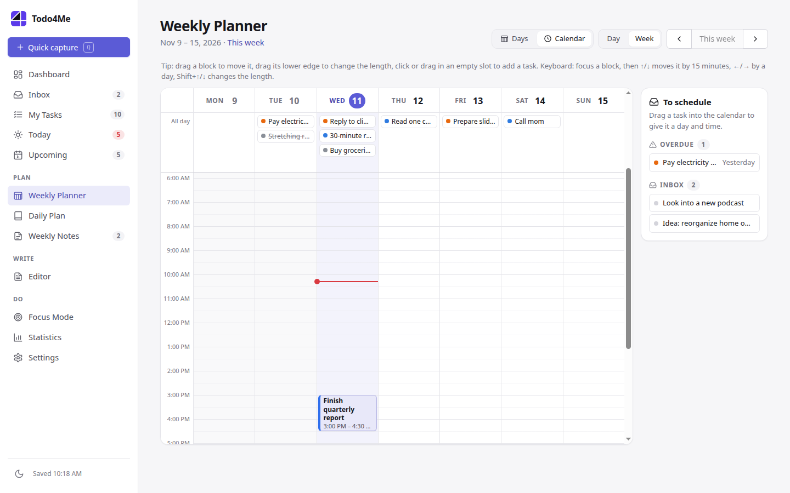

6. **Notes and documents.** *Weekly Notes* keeps thoughts and ideas by week (not everything has to be a task). In the **Editor** you write proper documents (headings, tables, images, formulas, code) and export them as PDF or Markdown; the *Feature tour* template shows everything.

   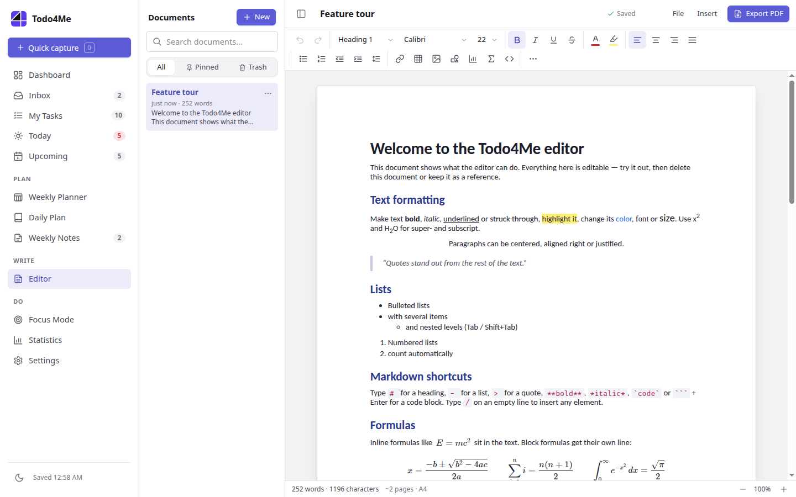

7. **Keep it running in the background (desktop app).** If you close the window, Todo4Me keeps running in the **tray** so reminders can appear. Press **`Ctrl+Alt+Space`** to open *Quick capture* from any program.
   To really quit: tray icon → *Quit Todo4Me*.

## Features at a glance

### Light and dark

The theme switches between **Light**, **Dark** and **System** under *Settings → Appearance → Theme*.

| Light | Dark |
|---|---|
|  | 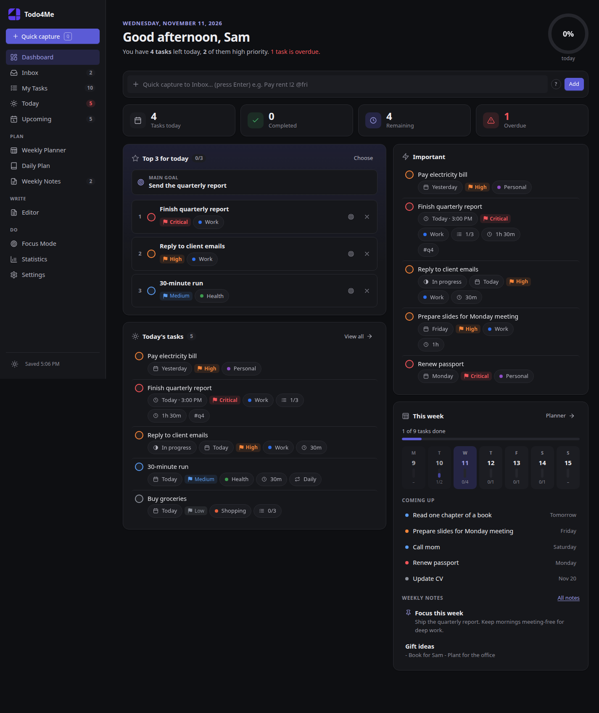 |
|  | 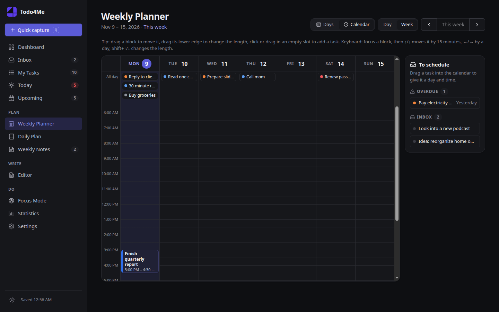 |
|  | 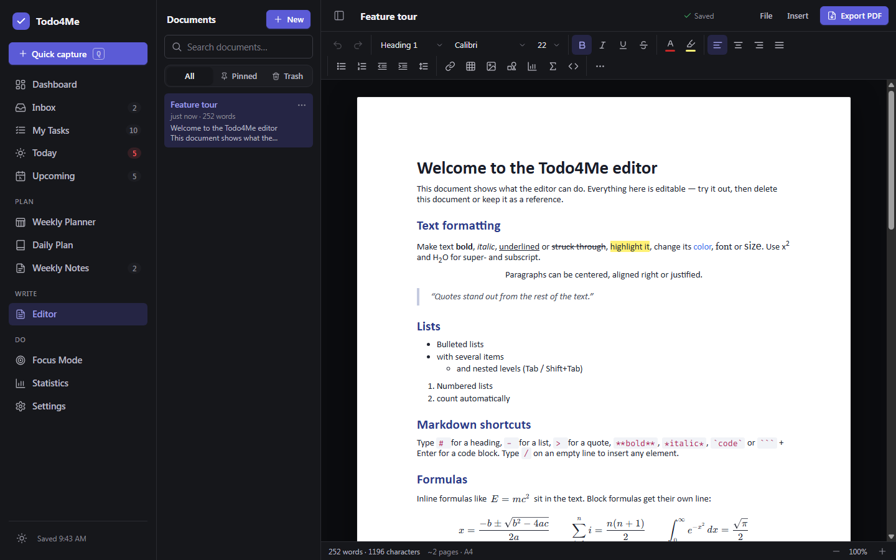 |

### More views

| | |
|---|---|
| 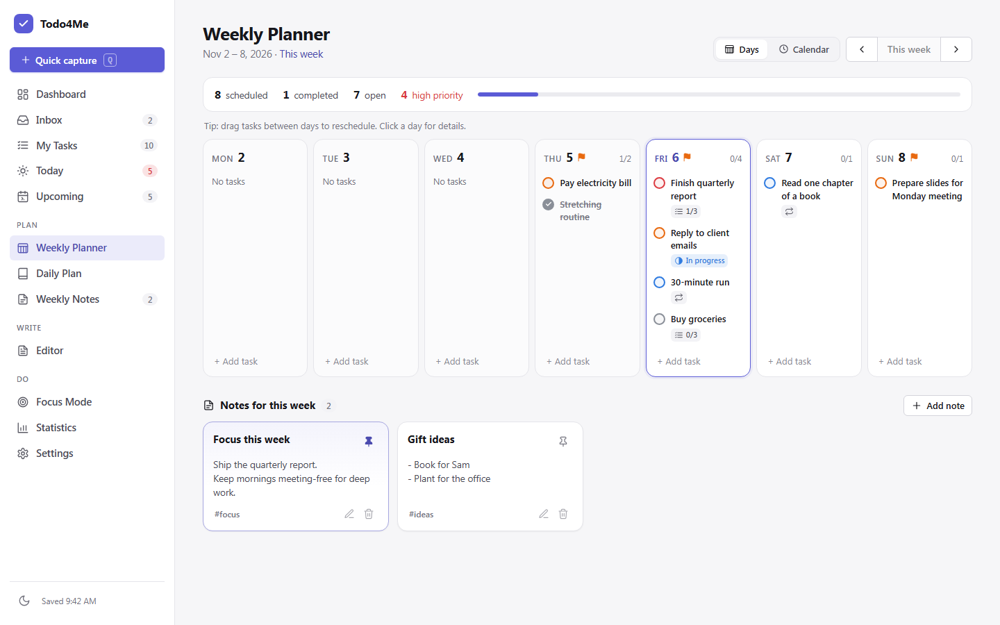 | 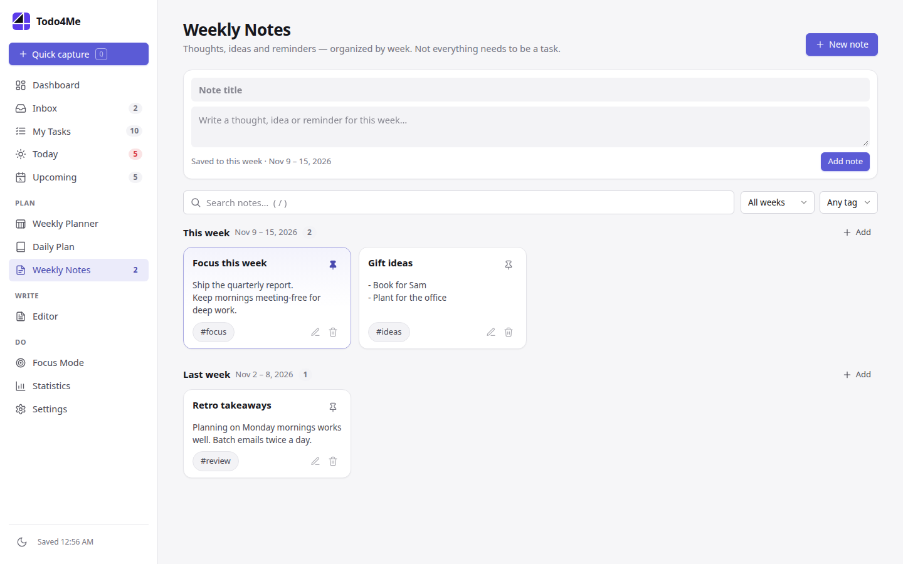 |
| **Weekly Planner** (Days) with weekly notes | **Weekly Notes** grouped by week |
| 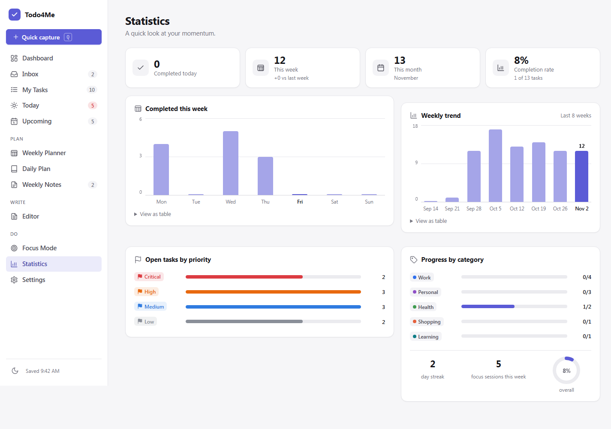 | 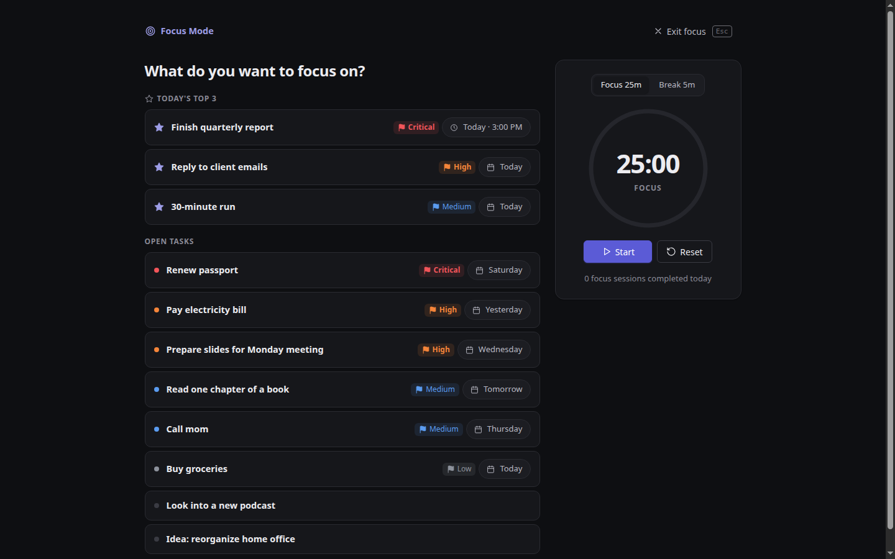 |
| **Statistics** | **Focus Mode** with Pomodoro timer |
| 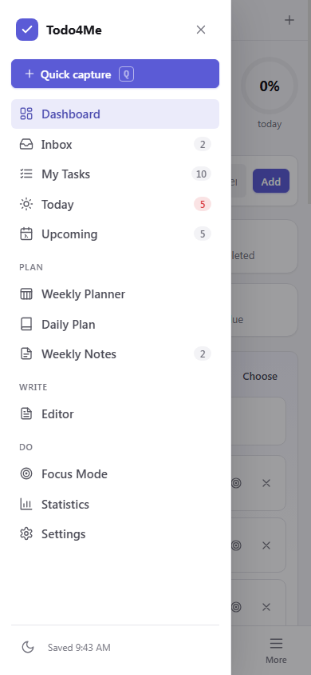 | |
| Navigation in the narrow (mobile) view | |

The screenshots are taken from the running app with sample data.

## Tips

**The most important shortcuts**

| Key | Action |
|---|---|
| `N` | New task |
| `Q` | Quick capture into the Inbox |
| `/` | Focus the search field (My Tasks, Weekly Notes) |
| `G` then `D` / `M` / `T` / `W` / `E` / `F` | Go to Dashboard / My Tasks / Today / Week planner / Editor / Focus |
| `Ctrl+Alt+Space` | Quick capture from anywhere (desktop app) |

**Quick-add examples**

| Input | Result |
|---|---|
| `Call mom @tomorrow` | Due tomorrow |
| `Report !1 #work @mon` | Priority 1 (Critical), category Work, Monday |
| `Buy milk #shopping` | Category Shopping (if no category matches, `#…` becomes a tag) |
| `Dentist @2026-12-24` | Due on the given date |
| `Team meeting every monday #work` | Repeats every Monday (first due on the next Monday), category Work |
| `Pay rent every 1st` | Repeats monthly on the 1st |

**Backup.** The desktop app automatically creates a backup every day (last 14 days, `%APPDATA%\Todo4Me\backups`). You can also save a file at any time under
*Settings → Data & backup → Export JSON* and restore it with *Import JSON*. More: [Data: saving, backup and restore](#data-saving-backup-and-restore).

**Updates.** The installed version checks for new versions by itself. When one is downloaded, an **Update** button in your accent color appears at the top of the sidebar; one click saves, installs and restarts. Manually: *Help → Check for updates*. Details: [Updates](#updates).

More: [Changelog](CHANGELOG.md) · [Guide for AI agents](docs/AGENT-GUIDE.md)

## Contents

- [Download & install](#download--install) · [Getting started](#getting-started) · [Tips](#tips)
- [All features](#all-features)
- [Updates](#updates)
- [Using it in the browser](#using-it-in-the-browser)
- [Desktop app in detail](#desktop-app-in-detail): [Data](#where-is-the-data-stored) · [Bringing over browser data](#bringing-over-data-from-the-browser-version) · [Menu and shortcuts](#menu-and-keyboard-shortcuts-of-the-desktop-app) · [Tray, reminders, quick capture](#in-the-background-tray-reminders-quick-capture)
- [Subscribing to calendars](#subscribing-to-calendars-outlook--google-read-only)
- [Reference](#reference): [Quick-add](#quick-add-syntax) · [Keyboard shortcuts](#keyboard-shortcuts) · [Calendar view](#weekly-planner-calendar-view) · [ICS](#ics-support) · [Document editor](#document-editor)
- [Data: saving, backup, restore](#data-saving-backup-and-restore)
- [For developers](#for-developers) (build, release, structure, data model, tests)
- [Browser support](#browser-support)

## All features

| Area | What you can do |
|---|---|
| **Dashboard** | Greeting and daily overview, stats for today, progress ring, **Daily Top 3** with main goal, today's tasks, important dates, weekly progress, quick capture |
| **Inbox** | Capture tasks without date, priority and category; with one click set them to Today/Tomorrow, sort them in the editor, or move them to My Tasks |
| **My Tasks** | Search (title, description, notes, tags, subtasks, category), filters by status, priority, category, date, tag, sorting |
| **Today / Upcoming** | Today plus overdue tasks ("all to today") · the next 14 days grouped by day, then "Later" |
| **Tasks** | Title, description, notes, priority (Critical / High / Medium / Low / none), status, category, tags, due date with optional time, estimate, subtasks, repeat (daily, weekdays, every n days/weeks/months/years, specific weekdays or day of month, or counted from completion), undo when completing and deleting |
| **Reminders** | Per task at the due time or 5/15/30 min, 1 h, 1 day before · Windows notification (also from the tray) · **Snooze 10 min** · each reminder only once |
| **Weekly Planner** | **Days \| Calendar** view: day columns with drag & drop, or an hourly grid with time blocks to move, resize and create |
| **Calendar subscriptions** | Outlook/Google calendars **read-only** via ICS link (desktop app) or `.ics` import |
| **Daily Plan** | Per day: main goal, top 3, tasks, notes and reflection, saved automatically |
| **Weekly Notes** | Notes with title, text, tags and pinning, grouped by week, with search and filters |
| **Editor** | Documents like in a word processor, with PDF and Markdown export |
| **Focus Mode** | Distraction-free view of one task with a Pomodoro timer (default 25/5), keeps running through a page reload |
| **Statistics** | Completed today/this week/this month, completion rate, streak, weekly chart, 8-week trend, open tasks by priority, progress per category |
| **Settings** | Name, theme light/dark/System, accent color, sorting, week start, Pomodoro, reminder time, calendars, categories, export/import, auto-backup, sample data, reset |

## Updates

The **installed** version updates itself:

1. Shortly after starting, and then every 4 hours, Todo4Me checks for a new version in the background.
2. If there is one, it is downloaded in the background ("Todo4Me 2.1.0 is available and is being downloaded…").
3. Then an **Update** button appears at the top of the sidebar, in your accent color (hover shows the version). One click saves everything, installs the update and restarts Todo4Me. If you don't click it, the update is installed the next time you quit.
4. After the restart, the app confirms "Todo4Me was updated to version 2.1.0". Tasks, notes, plans and documents are kept, because they live in `%APPDATA%\Todo4Me` and not in the program folder.

Status and the buttons **Check for updates** / **Restart & install** are under *Settings → Desktop app → Updates* and in the menu *Help → Check for updates*.
Without internet nothing disruptive happens: automatic checks fail silently, a manual check shows an understandable message.
The portable `.exe` and the developer version (`npm start`) do not update themselves and say so in the settings.

> **One-time step for existing users of versions 1.0.0–2.1.1:** 1.0.0 had no update feature, and 2.0.0–2.1.1 looked for updates in a former repository.
> Install `Todo4Me-Setup-2.1.2.exe` **once** over the old version (your data is kept). From then on, all further versions arrive automatically.

What changed in each version is listed in the [CHANGELOG](CHANGELOG.md).

## Using it in the browser

**Option 1: just open it.** Double-click `index.html` (or drag it into Chrome, Edge, Firefox or Safari). Everything works over `file://`.

**Option 2: serve it locally** (for a fixed address or several devices on your network):

```bash
python -m http.server 8080        # then open http://localhost:8080
npx serve .                        # or, with Node.js
```

> Data is stored per browser *and* per origin. `file:///…/index.html` and `http://localhost:8080`
> have separate data. Pick one option or move data via export/import.

## Desktop app in detail

### Where is the data stored?

- All data lives in the app's LocalStorage, in the fixed folder **`%APPDATA%\Todo4Me`** (e.g. `C:\Users\<Name>\AppData\Roaming\Todo4Me`).
  The installed and portable versions use the **same** folder and see the same data.
- Updates, reinstalling and **uninstalling do not delete this data.**
- The desktop app writes **one JSON backup per day** to `%APPDATA%\Todo4Me\backups` (the last 14 days are kept).
  What counts is the state at the first start of the day, so a later mishap does not overwrite it.
  Restore with **Import JSON**. You can open the folder via *File → Open backups folder* or *Settings → Desktop app*.
- The **editor documents** are stored in their own database (IndexedDB) in the same folder, separate from tasks and notes.
  They also get a daily backup: `backups\documents-YYYY-MM-DD.json` (including images, 14 days). Restore via *Settings → Documents → Import documents*.
- When you close the window, Todo4Me keeps running in the tray by default (see [below](#in-the-background-tray-reminders-quick-capture)).
  When really quitting (tray → *Quit Todo4Me*, *File → Exit*, update restart, shutdown/sign-out), the editor saves open changes before the app ends.
- The desktop app's settings (tray, autostart, shortcut) are stored in `%APPDATA%\Todo4Me\desktop-settings.json`. They apply to this computer only and are not part of export/import.
- Only **one** instance runs at a time. Starting it a second time brings the existing window to the front, so two windows never write the same data.

### Bringing over data from the browser version

The desktop app cannot read your browser's LocalStorage directly. Bringing the data over takes a minute, and **nothing is overwritten or deleted automatically**:

1. Open the old version in the browser (`index.html`) → **Settings → Export JSON**. The file `todo4me-backup-YYYY-MM-DD.json` is saved.
2. Open the desktop app → **Settings → Import JSON** (or *File → Import data*, `Ctrl+I`) → choose the file.
3. Choose **Merge**: existing data stays and the imported data is added. *Replace all* replaces everything and explicitly asks first.

The data in the browser stays unchanged. As long as the desktop app is empty, it points to this route on startup.

### Menu and keyboard shortcuts of the desktop app

All shortcuts of the web app (`N`, `Q`, `/`, `G` + letter …) keep working. In addition there is the menu:

| Menu | Shortcut |
|---|---|
| File → New task / Quick capture / New weekly note | `Ctrl+N` / `Ctrl+Shift+Space` / `Ctrl+Shift+N` |
| File → New document | `Ctrl+Alt+N` |
| File → Export document as PDF | `Ctrl+P` |
| File → Export data / Import data | `Ctrl+E` / `Ctrl+I` (in the editor, as in Word, `Ctrl+I` = italic, `Ctrl+E` = center, `Ctrl+N` = new document; via the menu, export/import/new task always work) |
| File → Open backups folder / Open data folder | |
| Go → Dashboard … Focus Mode / Settings | `Ctrl+1` … `Ctrl+9` / `Ctrl+,` |
| Go → Editor | `Ctrl+Shift+D` |
| View → Zoom, Full screen, Reload | `Ctrl+Plus/Minus/0`, `F11`, `Ctrl+R` |
| Help → Check for updates | |
| **System-wide** (also in other programs): Quick capture | `Ctrl+Alt+Space` (configurable) |

### In the background: tray, reminders, quick capture

**Tray and closing.** Todo4Me shows an icon in the notification area of the taskbar. A click opens the window, a right-click opens the menu
(*Open Todo4Me*, *Quick capture*, *New task*, *Quit Todo4Me*). Closing the window (X, `Alt+F4`) **only hides it**, so reminders also appear while the window is closed.
The first time, a Windows notification points this out once. **To really quit:** tray → *Quit Todo4Me* or *File → Exit*; the rule "save first, then close" still applies.
Shutting down or signing out of Windows ends Todo4Me properly, as does *Restart & install*. A downloaded update is installed as soon as Todo4Me really quits (or immediately with the **Update** button).

**Reminders.** The task editor has a **Reminder** field: *At due time*, 5/15/30 minutes, 1 hour or 1 day before.
What counts is the due date and time. If the task only has a date, the **Reminder time** from *Settings → Tasks & planning* applies (default 09:00).
If there is no date, the task is set to today when saved. At the due time a **Windows notification** appears (also while running in the tray):
a click opens the task, **Snooze 10 min** reminds you again ten minutes later. In the app, a message with *Open* and *Snooze 10 min* appears as well.

- Each reminder appears **only once** (even after a restart), and never for completed tasks. If the task is moved, the new date gets a new reminder.
- Recurring tasks: the next repetition automatically gets its own reminder.
- If Todo4Me was closed when reminders came due, **one** summary message ("2 reminders missed") appears at the next start.
- Accuracy: about to the minute. If the window stays hidden for a long time, Chromium slows timers down to once per minute.
- Test: *Settings → Tasks & planning → Reminder notifications → Test*. If Windows suppresses notifications (e.g. "Do not disturb"), the message stays in the app.
- In the browser you get the same as a browser notification (if allowed) and always as a message in the app.

**Quick capture from anywhere.** `Ctrl+Alt+Space` brings Todo4Me to the front and opens *Quick capture*, even from another program.
Alternatives you can choose: `Ctrl+Shift+Alt+Space`, `Ctrl+Alt+T`, `Ctrl+Shift+Alt+T`. Combinations that produce characters on German keyboards
(`AltGr` = `Ctrl+Alt`, e.g. `AltGr+Q` = `@`) are deliberately not offered. If a dialog is open, it is not replaced (nothing you typed is lost).
If the shortcut is already taken, the settings page tells you.

**Settings** under *Settings → Desktop app*:

| Setting | Default |
|---|---|
| Keep running in the tray when the window is closed | on |
| Start Todo4Me when Windows starts (starts invisibly in the tray) | off. Only in the installed version; turn it off before uninstalling, otherwise an orphaned autostart entry remains |
| System-wide shortcut / Shortcut | on / `Ctrl+Alt+Space` |

### Subscribing to calendars (Outlook / Google, read-only)

In the **Weekly Planner**, next to the day columns, there is the **Calendar** view (see [Calendar view](#weekly-planner-calendar-view)).
Events from Outlook or Google Calendar can appear there, **for viewing only**, in the calendar's color and hatched so they are not mistaken for tasks. The dashboard also shows "Calendar today".

**Set up** under *Settings → Calendars*: choose a name and color, paste the calendar link, **Subscribe**. You get the link here:

- **Outlook** (web/Microsoft 365): *Settings → Calendar → Shared calendars → Publish a calendar* → choose the calendar and "Can view all details" → copy the **ICS link**.
- **Google Calendar**: *Settings → (select the calendar on the left) → Integrate calendar* → **Secret address in iCal format**.

It works without signing in (no OAuth): Todo4Me only downloads this ICS file. `https://` and `webcal://` addresses are allowed.
Calendars are refreshed **at startup, every 30 minutes**, and with the *Update* button.
If that fails (offline, link reset, server error), the reason is shown next to the calendar and the last loaded version stays visible.
Instead of a link you can **import an `.ics` file** (it is not updated automatically).

> **The link is a secret:** Anyone who knows it can read the calendar. Todo4Me stores it only on this computer
> (its own LocalStorage key, **not** in export, import or daily backup files), shows it only shortened (`outlook.office365.com/••••••••`)
> and never writes it to a log. Remove it with the trash icon; *Reset all data* deletes it as well.

**In the browser** (without the desktop app), subscribing by link is not possible: browsers do not let a page load calendars from other servers (CORS),
and the page's security policy forbids network access. There, only the `.ics` import is available, and the settings say so.

<details>
<summary>Technical details of the calendar download</summary>

The download runs in the main process (`electron/calendar.js`) through the only new bridge function `fetchCalendar(url)`. It checks:
only `https://` (`webcal://` becomes `https://`), no credentials in the address, redirects only to `https://` (max. 5), at most 5 MB, 20 s time limit,
at most 4 downloads at the same time, its own in-memory session without cookies and without credentials (password prompts are rejected),
and the response must be an iCalendar file. The system proxy and the Windows certificate store apply, as in the browser.
The file is parsed in the page (`js/ics.js`, see [ICS support](#ics-support)).

</details>

## Reference

### Quick-add syntax

Every "Add a task…" field (and Quick capture) understands:

| Token | Meaning |
|---|---|
| `!1` `!2` `!3` `!4` (or `!critical`, `!high`, `!medium`, `!low`, `!c`, `!h`, `!m`, `!l`) | Priority |
| `#work` | Category (name or beginning of it). If no category matches, it becomes a **tag** |
| `@today` `@tomorrow` `@mon`…`@sun` `@nextweek` `@2026-12-24` | Due date |
| `every day` · `every weekday` · `every week` · `every month` · `every year` | Repeat |
| `every monday` · `every mon,wed,fri` · `every other week` · `every 2 weeks` · `every 3 days` · `every 2 months` | Repeat on weekdays or at an interval (1–99) |
| `every 15th` · `every last day` | Repeat monthly on that day of the month / on the last day |
| `… after done` (e.g. `every 3 days after done`) | Count the next date from the completion day instead of the due date |
| `*daily` `*weekly` `*monthly` `*yearly` `*weekdays` | Shorthands (need the `*`, so ordinary words stay in the title) |

Example: `Send invoice !2 #work @fri`, `Team meeting every monday #work`

A repeat phrase is only recognized when it is complete: `Read every chapter` or `every 0 days` stay plain text. Without an `@date` the first due date is the first matching day (today for `every day`, the next Monday for `every monday`).

In the Inbox, a token for date, priority, category or repeat automatically sorts the task into My Tasks.

### Keyboard shortcuts

| Key | Action |
|---|---|
| `N` | New task |
| `Q` | Quick capture into the Inbox |
| `/` | Focus the search field (My Tasks, Weekly Notes) |
| `G` then `D` / `I` / `M` / `T` / `U` / `W` / `P` / `O` / `E` / `F` / `S` | Go to Dashboard / Inbox / My Tasks / Today / Upcoming / Week planner / daily Plan / nOtes / Editor / Focus / Stats |
| `Ctrl/⌘ + Enter` | Save the open task or note form |
| `Esc` | Close dialog or leave Focus Mode |
| `↑` / `↓` on a focused calendar block | Move the task 15 minutes earlier / later |
| `←` / `→` on a focused calendar block | Move the task to the previous / next day |
| `Shift + ↑` / `↓` on a focused calendar block | Make the task 15 minutes shorter / longer |
| `Esc` while dragging in the calendar | Cancel the drag |

Editor shortcuts are listed in the [Document editor](#document-editor), desktop app shortcuts [above](#menu-and-keyboard-shortcuts-of-the-desktop-app).

### Weekly Planner: Calendar view

The header of the Weekly Planner has a **Days | Calendar** switch. *Days* is the unchanged planner with day columns.
*Calendar* shows the same week (same week start, same navigation) as an **hourly grid**, or a single day (**Day | Week**; clicking a day header opens it).
The grid opens at 06:00 and scrolls from 00:00 to 24:00; a red line marks the current time. Your choice is remembered, and `#/planner?view=calendar` opens the view directly
(this is what "Open calendar" in the dashboard uses). On narrow screens (≤ 760 px) the calendar always shows one day.

| In the calendar | What happens |
|---|---|
| Task with date **and** time | Block starting at the time; height = estimate (30 min if none). Overlapping blocks are placed side by side. Completed ones are dimmed |
| Task with date, without time | Chip in the day's **All day** strip |
| Drag a block | Moves it to another time and/or day (15-minute steps); dragged onto the All-day strip, the date stays and the time is removed |
| Drag the bottom edge of a block | Changes the estimate (15-minute steps) |
| Drag an All-day chip or a task from **To schedule** (overdue, Inbox, no date) in | Puts it on a day and time (an Inbox task leaves the Inbox) |
| Click a block / chip | Opens the usual task editor |
| Click / drag across free time | Opens *New task* with day, start time (and duration); `+` in the All-day strip creates a task without a time |
| Events from subscribed calendars | Read-only, hatched blocks in the calendar's color; click shows details |

Every change is saved like any other (`store.commit()`), and the message offers **Undo**. Reminders move with the task because they are stored relative to the due time;
moving also clears a pending snooze time (like the task editor). Touch: press and hold a block briefly, then drag.

### ICS support

Calendar files are parsed by `js/ics.js` (no library): `VEVENT` with `DTSTART` + `DTEND` or `DURATION`, all-day and multi-day events (`VALUE=DATE`, end exclusive),
line folding, escaped text, `STATUS:CANCELLED` (skipped) and recurring events with `RRULE` `FREQ=DAILY/WEEKLY/MONTHLY/YEARLY` including `INTERVAL`, `COUNT`, `UNTIL`,
`BYDAY` (also `2TU`, `-1FR`), `BYMONTHDAY` (also negative), `BYMONTH`, `BYSETPOS`, `WKST`, `EXDATE` and `RECURRENCE-ID` (individual moved or cancelled occurrences).
Series are expanded only for the visible days. Not supported (ignored): `RDATE`, `BYWEEKNO`, `BYYEARDAY`, `BYHOUR`/`BYMINUTE`, `HOURLY` and finer (such an event appears once).

**Time zones:** `…Z` times are UTC; a `TZID` is resolved with the browser's time zone database (`Intl`), including Mozilla IDs and the Windows names that Outlook writes
(`W. Europe Standard Time` → `Europe/Berlin`); otherwise the file's `VTIMEZONE` rules apply. An unknown `TZID` and times without a zone ("floating") are treated as
the **local time** of this computer. Recurring events are expanded in their own zone, so an event at 10:00 Berlin stays at 10:00 Berlin even when daylight saving time changes;
everything is displayed in this computer's local time. Single events that ended more than 180 days ago are not kept.

### Document editor

A separate **Editor** page in the navigation (section *Write*, shortcut `G` then `E`). Weekly Notes stay unchanged and independent of it.

**Layout:** on the left the document list (search in title and content, *All / Pinned / Trash*, "…" menu per document),
at the top the title, save status, the **File** and **Insert** menus and the **Export PDF** button, below them the formatting toolbar,
in the middle the page (paper view in the chosen format), at the bottom words/characters/pages and zoom (25–300 %, also with **Ctrl + mouse wheel**; the spot under the pointer stays in place).
With no document open, the page shows templates (*Blank, Meeting notes, Report, Feature tour*) and the most recently edited documents.

| Area | Features |
|---|---|
| Documents | New, from template, open, rename, duplicate, pin, move to Trash (restorable for 30 days), delete permanently, search, import (`.md`, `.html`, `.txt`, Todo4Me `.json`) |
| Saving | Automatically ~0.7 s after each change, immediately when switching page or document and when closing. `Ctrl+S` saves immediately. Status at the top: *Saved / Editing… / Not saved — retrying* |
| Undo | `Ctrl+Z` / `Ctrl+Y` (also `Ctrl+Shift+Z`) for **all** changes, including tables, images, shapes, charts, formulas |
| Text | Bold, italic, underline, strikethrough, highlighter, text and background color, font size (8–72 pt), font, superscript/subscript, inline code, clear formatting |
| Paragraph | Normal, Heading 1–6, quote, left/center/right/justified, bulleted list, numbered list (nested with Tab), indent, line spacing, spacing before/after, paragraph shading, horizontal rule, page break |
| Fonts | **Calibri** (default), **Fira Code**, Arial, Georgia, Times New Roman, Verdana. Fira Code is bundled. Where Calibri is missing (macOS, iPad), the metrically identical bundled *Carlito* is used automatically |
| Links | `Ctrl+K` insert/edit, a click shows the address with *Open / Edit / Remove*, `Ctrl+click` opens in the browser |
| Tables | Grid selection or free size, header row, insert and delete rows/columns, cell color, `Tab` jumps to the next cell (adds a new row at the end) |
| Images | Insert via button, from the clipboard, or by drag & drop · size by dragging or 25/50/75/100 % · left/center/right or text wrap · caption, alt text, replace. Large images are shrunk automatically |
| Shapes | Circle, rectangle, rounded rectangle, triangle, line, arrow, diamond in a drawing canvas · move (mouse or arrow keys), resize with handles (`Shift` = proportional), fill and border color, border width (0–20 px), text in the shape, duplicate (`Ctrl+D`), delete (`Del`), bring forward/send back · canvas height via handle |
| Charts | Bar, line, pie · edit data in a table (double-click), multiple data series, colors, title, legend · vector graphics in the PDF |
| Formulas | LaTeX formula editor (`Ctrl+M`) with live preview and symbol palette (fractions, roots, powers, subscripts, sums, integrals, limits, matrices, Greek letters, symbols) · inline or as its own block · rendered with KaTeX |
| Code | Code blocks with syntax highlighting for JavaScript, Python, HTML, CSS, JSON, Java, C++, C, C#, SQL, Bash · Fira Code · selectable language · copy button · `Tab` indents, `Esc` leaves the block |
| Markdown shortcuts | `# ` to `###### ` headings, `- ` list, `1. ` numbering, `> ` quote, `**bold**`, `*italic*`, `` `code` ``, `~~strike~~`, `==highlighted==`, ```` ``` ```` + Enter code block, `---` + Enter rule, `$$` + Enter formula. `/` on an empty line opens the Insert menu. Pasted Markdown text is converted |
| PDF | **Export PDF** (`Ctrl+P`): clean layout with sensible page breaks (headings stay with their text, table rows, images, formulas and code blocks are not split, table headers repeat), embedded fonts, vector graphics, bookmarks from the headings. **File → Page setup**: A4/Letter/A5/Legal, portrait/landscape, margins, header and footer (placeholders `{title}`, `{date}`), page numbers ("Page 1 of 3", "1 / 3", "1"), first page without header. The PDF matches the page in the editor (white paper, same margins, header/footer centered in the margin); dashed lines on the page show roughly where a new PDF page begins. Desktop app: Save dialog, browser: print dialog ("Save as PDF"). The document itself stays unchanged |
| Export | Markdown (`.md`, Obsidian-compatible, images/charts embedded) and Todo4Me document (`.json`, lossless) · *Settings → Documents* exports/imports all documents |

**File format:** Documents are stored internally as sanitized HTML (only allowed elements, attributes and style properties) plus JSON metadata,
not as PDF or Markdown, because Markdown cannot represent colors, fonts, alignment, shapes and charts without loss.
Images, shapes, charts, formulas and code blocks are "widgets" that store only their source data (e.g. LaTeX text, chart values) and
are redrawn when opened, so they always remain editable. Markdown is the exchange format for import and export.
Everything that enters a document (loading, pasting, import, undo) passes through `editor-sanitize.js`: scripts, event handlers,
`javascript:` links, external resources and foreign style properties are removed.

**Offline:** KaTeX, Prism and the fonts are in `vendor/` and are only loaded when the editor is opened (so the rest of the app starts quickly).

## Data: saving, backup and restore

- **Automatic saving.** Every change is written to `localStorage` immediately. The sidebar shows the last save time and warns if saving fails (e.g. storage full).
- **Automatic backup.** A second copy (`todo4me.backup.v1`) is renewed at most once a day. If the main data is unreadable, the app restores this backup at startup.
  The damaged copy is kept under `todo4me.corrupt.<timestamp>`, and you are informed. Manually: **Settings → Restore auto-backup**.
- **Validation.** All data (from storage or an import) passes through a sanitizer: unknown fields are dropped, invalid values fall back to safe defaults, entries that cannot be repaired are skipped and reported.
- **Multiple tabs** stay in sync: a change in one tab updates the others.
- **Every destructive action is confirmed** (deleting a task, note or category; import with replace; restoring a backup; reset).

**Export (backup):** *Settings → Data & backup → Export JSON* downloads `todo4me-backup-YYYY-MM-DD.json` with all tasks, notes, categories, daily plans, settings and statistics.

**Import (restore or move to another device):** *Settings → Data & backup → Import JSON*, choose the file. You see what the file contains and choose:

- **Merge**: current data stays, the file's entries are added. If an entry exists in both, the most recently changed one wins. Your settings stay.
- **Replace all** (with confirmation): replaces everything, including the settings, with the file's content.

**Reset:** *Settings → Reset all data* deletes everything Todo4Me has stored in this browser, including calendar subscriptions (export first).

## For developers

Source code: <https://github.com/muelgerhbf/todo4me> (public). Ready-made installers are in the [Releases](https://github.com/muelgerhbf/todo4me/releases) of this repository.
Working guide for AI agents: [docs/AGENT-GUIDE.md](docs/AGENT-GUIDE.md). Changes per version: [CHANGELOG.md](CHANGELOG.md).

<details>
<summary><strong>Development and build</strong></summary>

Requirement: [Node.js](https://nodejs.org) 20 or newer.

```bash
npm install              # once: install Electron, electron-builder, electron-updater
npm start                # start the desktop app from source
npm run dev              # like start, plus DevTools open
npm run vendor           # only after updating KaTeX/Prism/fonts: copies them to vendor/
```

Changes to `index.html`, `css/` or `js/` show up after **Ctrl+R** in the app window.

> If `npm install` reports that install scripts were blocked (npm 11), and `npm start` shows "Electron failed to install correctly",
> run `node node_modules/electron/install.js` once. This downloads the Electron program.

**Build installer and portable**

```bash
npm run build            # both: installer + portable
npm run build:installer  # only Todo4Me-Setup-<version>.exe
npm run build:portable   # only Todo4Me-<version>-portable.exe
npm run pack             # only the unpacked app in dist/win-unpacked (for quick testing)
```

The finished files are in **`dist/`**. The first build downloads tools once (NSIS, Electron for Windows). The version number is in `package.json` and in the file name.
`scripts/build.js` lets electron-builder work in a temporary folder outside the project and copies only the finished `.exe` files to `dist/`.
Reason: if the project is open in VS Code, VS Code (itself an Electron app) locks newly created `.asar` files, and a direct build aborts with `EBUSY`/`EPERM`.

</details>

<details>
<summary><strong>Publishing an update (release process)</strong></summary>

Updates are published as *Releases* of this repository (`muelgerhbf/todo4me`), configured in `package.json → build.publish`.
The app checks the latest published release anonymously, so the repository must stay **public**. (Versions 2.0.0–2.1.1 still look in the former repository `todo4me-releases`; users of those versions install 2.1.2 once manually.)

**One-time setup**

1. GitHub → *Settings → Developer settings → Personal access tokens → Fine-grained tokens* → **Generate new token**:
   Repository access *Only select repositories → todo4me*, permission *Contents: Read and write*.
2. Store the token as an environment variable (PowerShell, once; then reopen the terminal):
   `[Environment]::SetEnvironmentVariable('GH_TOKEN', '<token>', 'User')`

**For every update**

1. Increase the version number in `package.json`. It must **always be greater** than the last one.
2. `npm run release`. Builds installer + portable and uploads them with `latest.yml` to GitHub as a **draft**.
3. On GitHub under *todo4me → Releases*, check the draft and click **Publish release**. From now on everyone gets the update.

Never delete files from the latest release: the app reads `latest.yml` there. You fix a faulty update with a new, higher version.
`npm run build` (without upload) also puts `latest.yml` and `*.blockmap` into `dist/`, for testing or for your own web server.

</details>

<details>
<summary><strong>Desktop integration and security</strong></summary>

```
electron/main.js     Main process: window, fixed data folder, single instance, menu,
                     save dialog for exports, daily backup files, PDF export,
                     "save first, then close", security rules
electron/updater.js  Automatic updates (electron-updater, GitHub Releases)
electron/background.js  Tray, closing to the tray, autostart, system-wide shortcut,
                     Windows notifications (desktop-settings.json)
electron/calendar.js Download of subscribed calendars (ICS): https only, size/time limit, no cookies
electron/preload.js  Minimal, fixed interface window.todo4meDesktop (contextBridge)
js/desktop.js        Connects menu, tray, shortcuts, backup files, updates and migration hint
                     to the web app. Without Electron (in the browser) this file does nothing.
js/reminders.js      Reminders: scheduling, firing once, snooze (browser and desktop)
js/calfeeds.js       Calendar subscriptions: list, cache, refresh via fetchCalendar (in the browser only .ics import)
scripts/start.js     Starts Electron for npm start/dev
scripts/build.js     Build script, with --publish for releases
scripts/vendor.js    Copies KaTeX, Prism and the fonts from node_modules to vendor/
build/icon.png       App icon (generated from assets/icons/favicon.svg), electron-builder turns it into the .ico
```

**Security:** `contextIsolation: true`, `nodeIntegration: false`, `sandbox: true`.
- The page has no access to Node.js, only to the fixed functions from `preload.js`
  (info, backup files, open folder, PDF export, open exported file, updates, menu commands, calendar download,
  desktop settings, show notification). The main process validates every value (e.g. only the four shortcut presets, text lengths).
- Navigation away from the app and new windows are blocked. `http(s)` links open in the default browser.
- All permission requests (camera, microphone, location, also web notifications …) are denied. Reminders are shown by the main process, not the page.
- A Content Security Policy in `index.html` allows only local files (`connect-src 'none'`: the page itself loads nothing from the network;
  calendars are loaded exclusively by the main process via `fetchCalendar`). All texts from calendar files are displayed as text (HTML-escaped).
  The small inline script in the `<head>` is allowed by its SHA-256 hash. Anyone who changes it must update the hash in the CSP.

</details>

<details>
<summary><strong>Project structure and architecture</strong></summary>

```
todo4me/
├── index.html            App shell, icon sprite (inline SVG), dialogs, script includes
├── package.json          Desktop app: npm scripts + electron-builder configuration (+ update feed)
├── electron/
│   ├── main.js           Main process (window, data folder, menu, backups, PDF, security)
│   ├── updater.js        Automatic updates (electron-updater)
│   ├── background.js     Tray, closing to the tray, autostart, global shortcut, native notifications
│   ├── calendar.js       Loads subscribed calendars (ICS): https only, limits, no cookies
│   └── preload.js        Minimal bridge window.todo4meDesktop
├── scripts/              start.js, build.js, vendor.js
├── build/icon.png        App icon for electron-builder
├── assets/icons/         favicon.svg, icon.png (window icon)
├── docs/                 AGENT-GUIDE.md, screenshots/
├── vendor/               Offline files for the editor (MIT / SIL OFL, licenses included)
│   ├── katex/            Formula rendering + fonts
│   ├── prism/prism.js    Syntax highlighting (11 languages)
│   └── fonts/            Fira Code, Carlito (Calibri-compatible)
├── tests/                Browser and desktop tests (Chrome DevTools Protocol, no npm dependencies),
│                         ICS parser tests (test-ics.mjs) with fixtures (fixtures/ics/)
├── css/
│   ├── styles.css        Design tokens (light/dark), components, views, responsive rules
│   └── editor.css        Editor page, document typography, widgets, print/PDF rules
└── js/
    ├── utils.js          Date helpers (local YYYY-MM-DD), HTML escaping, DOM helpers
    ├── storage.js        Schema defaults, validation/sanitizing, storage adapter, backup, import/export/merge
    ├── store.js          In-memory state, all changes (commit → save → notify), selectors
    ├── ui.js             Action registry, modal, confirm dialog, toasts, progress components
    ├── tasks.js          Task row/editor, quick capture, quick-add parser; Inbox, My Tasks, Today, Upcoming
    ├── dashboard.js      Dashboard, Top 3 card and selection
    ├── planner.js        Weekly Planner (drag & drop, day details) and Daily Plan
    ├── ics.js            iCalendar parser + recurrence expansion (pure, also runs in Node for the tests)
    ├── calfeeds.js       Calendar subscriptions: list, cache, refresh, settings card, dashboard card
    ├── calendar.js       Weekly Planner → Calendar view: hourly grid, drag & drop, resize, create, keyboard
    ├── notes.js          Weekly Notes
    ├── focus.js          Focus Mode and Pomodoro timer
    ├── stats.js          Statistics and charts
    ├── settings.js       Settings, theme, calendar card, categories, export/import, sample data
    ├── editor-sanitize.js  Editor: HTML allowlist sanitizer (paste, import, storage, undo)
    ├── docstore.js       Editor: IndexedDB storage for documents and images, export/import
    ├── editor-widgets.js Editor: images, drawings/shapes, charts, formulas, code blocks, dialogs
    ├── editor-markdown.js Editor: Markdown import/export
    ├── editor-core.js    Editor: editing engine (selection, undo/redo, formatting, tables, links, paste)
    ├── editor.js         Editor: page, document list, toolbar, menus, autosave, PDF export
    ├── app.js            Router (hash), navigation, event delegation, shortcuts, startup
    ├── reminders.js      Reminder scheduler (fire once, snooze, summary message) + notifications
    └── desktop.js        Desktop-only additions (inactive in the browser)
```

- **Plain JavaScript (ES2020), no build.** Classic scripts with a shared namespace `window.T4` instead of ES modules, so the app also runs directly from disk (`file://`), where browsers block module imports.
- **One-way data flow.** Views are functions `render(params) → HTML string`. Every change goes through `T4.store.commit()`, which saves and notifies the app, which re-renders the current view. Focus and half-typed quick-add text are preserved.
- **Event delegation.** Interactive elements declare `data-action="name"` (clicks), `data-form` (submits), `data-input` / `data-change` (inputs). Modules register handlers with `T4.ui.on(name, fn)`.
- **All user content is HTML-escaped before rendering.**
- **Backend-ready.** Persistence lives in `storage.js` behind an adapter with `load(key)` / `save(key, value)` / `remove(key)`. For a server, replace these and call `T4.storage.setAdapter(adapter)`. Every entity already has a stable string `id` and `createdAt`/`updatedAt`, and `storage.merge()` already does last-write-wins reconciliation.

</details>

<details>
<summary><strong>Data model (JSON)</strong></summary>

Everything is stored as one JSON document under the `localStorage` key `todo4me.data.v1`. Exports have the same shape plus `app` and `exportedAt`.
Dates are local calendar days (`"YYYY-MM-DD"`), times `"HH:MM"` (24 h), timestamps ISO-8601 strings.

```jsonc
{
  "version": 1,
  "tasks": [Task],
  "categories": [Category],
  "notes": [Note],
  "dailyPlans": { "YYYY-MM-DD": DailyPlan },
  "settings": Settings,
  "stats": Stats,
  "meta": { "createdAt": "ISO", "updatedAt": "ISO" }
}
```

### Task

```jsonc
{
  "id": "task_lz1k2…",           // unique string
  "title": "Finish quarterly report",   // required, ≤ 500 characters
  "description": "",
  "notes": "",
  "status": "todo",              // "todo" | "in_progress" | "done"
  "priority": "high",            // "critical" | "high" | "medium" | "low" | null (none)
  "categoryId": "cat_work",      // Category.id or null
  "tags": ["q4", "reports"],     // lowercase, unique, ≤ 20
  "dueDate": "2026-11-02",       // or null
  "dueTime": "15:00",            // or null (only with dueDate)
  "estimate": 90,                // minutes (1–1440) or null
  "subtasks": [{ "id": "sub_…", "title": "Collect numbers", "done": true }],
  "recurrence": null,            // "daily" | "weekly" | "monthly" | null
  "reminder": 15,                // minutes before due (0 = at due time, max 40320) or null; needs dueDate
  "reminderFired": "2026-11-02 15:00|15", // occasion the reminder was shown for ("date time|minutes"), or null
  "reminderSnooze": null,        // ISO time at which a snoozed reminder returns, or null
  "inbox": false,                // true = captured, not yet sorted
  "nextOccurrenceId": null,      // set once a repetition has created its successor
  "createdAt": "2026-11-02T08:12:00.000Z",
  "updatedAt": "2026-11-02T09:30:00.000Z",
  "completedAt": null            // set when the status becomes "done"
}
```

**Recurring tasks:** Completing creates the next repetition (subtasks reset) on the first interval after today. Reopening and completing again does not create duplicates.

**Reminders** are stored as an offset (`reminder`, minutes before due), not as an absolute time: they move with the task when it is rescheduled
(editor, planner drag & drop, "all to today"), and the next repetition inherits the offset and gets its own reminder.
The trigger time is `dueDate` + (`dueTime` or `settings.reminderTime`) − `reminder`. `reminderFired` remembers which occasion has already been shown,
so a reminder appears only once, even across restarts, imports and other tabs; if the date/time or offset changes, a new key results.
Data without these fields (older versions and exports) loads unchanged with `reminder: null`.

### Category

```jsonc
{ "id": "cat_work", "name": "Work", "color": "#2f6fed" }
```

Defaults: Work, Personal, Health, Shopping, Learning, Other. When a category is deleted, its tasks are kept (`categoryId: null`).

### Note

```jsonc
{
  "id": "note_…",
  "title": "Ideas for the launch",   // title or text required
  "body": "Free text, line breaks preserved",
  "weekOf": "2026-11-02",            // start date of the week the note belongs to
  "tags": ["ideas"],
  "pinned": true,                    // pinned = important; shown first and in the dashboard
  "createdAt": "ISO",
  "updatedAt": "ISO"
}
```

Notes are grouped by the week that contains `weekOf`, according to the *Week start* setting.

### DailyPlan

```jsonc
{
  "date": "2026-11-02",
  "goal": "Send the quarterly report",
  "top3": ["task_a", "task_b", "task_c"],   // up to 3 existing task IDs, in order
  "notes": "",
  "reflection": "",
  "updatedAt": "ISO"
}
```

### Settings

```jsonc
{
  "userName": "",
  "theme": "system",          // "light" | "dark" | "system"
  "accent": "#5b5bd6",        // hex color
  "defaultSort": "priority",  // "priority" | "due" | "created" | "alpha" | "status"
  "weekStart": 1,             // 1 = Monday, 0 = Sunday
  "showCompleted": true,
  "pomodoroFocus": 25,        // minutes
  "pomodoroBreak": 5,         // minutes
  "reminderTime": "09:00"     // "HH:MM": reminder time for tasks with a date but no time
}
```

### Stats

```jsonc
{
  "completions":   { "2026-11-02": 4 },   // completed tasks per day
  "focusSessions": { "2026-11-02": 2 }    // completed Pomodoro focus sessions per day
}
```

Completions are counted per day when ticking off (and subtracted when reopening), so the history is kept even after deleting completed tasks.

### Other localStorage keys

| Key | Purpose |
|---|---|
| `todo4me.backup.v1` | `{ "at": ISO, "data": <full document> }`, the daily automatic backup |
| `todo4me.focus.v1` | Focus Mode state: chosen task and timer (`mode`, `running`, `endsAt`, `remaining`) |
| `todo4me.corrupt.<ms>` | Quarantined unreadable data (only when corruption is detected) |
| `todo4me.editor.ui` | Editor view: `{ "zoom": 100, "side": true }` (document list visible) |
| `todo4me.app.version` | Desktop app: last started version (confirms an update once) |
| `todo4me.docs.backupDay` | Desktop app: day of the last document backup file |
| `todo4me.planner.ui` | Weekly Planner view: `{ "mode": "days" \| "calendar", "span": "week" \| "day" }` |
| `todo4me.calendars.v1` | Calendar subscriptions (see below). **Not** part of `todo4me.data.v1`, exports, imports, merges or backup files, because the links are secrets |
| `todo4me.calendars.cache.v1` | Last loaded/imported version of each calendar, already parsed: `{ "<feedId>": { "at": ISO, "checkedAt": ISO, "error": null, "cal": { "name", "events": [Event], "zones": {} } } }`. Size-limited (~1.5 M characters; descriptions are dropped first), so it never displaces the tasks |

```jsonc
// todo4me.calendars.v1
{
  "version": 1,
  "feeds": [{
    "id": "cal_…",
    "name": "Work",                  // ≤ 60 characters
    "color": "#0e7c86",
    "kind": "url",                   // "url" (subscription, desktop app) | "file" (imported .ics, no URL)
    "url": "https://outlook.office365.com/owa/calendar/…/calendar.ics",   // https only (webcal:// is stored as https://)
    "enabled": true,                 // "Show" checkbox
    "addedAt": "ISO"
  }]
}
// Event in the cache (js/ics.js): wall-clock times, expanded per visible range
{ "uid": "…", "title": "…", "location": "…", "description": "…", "allDay": false,
  "start": 1793785200000,            // wall-clock ms in the event's zone (all-day: day × 86400000)
  "tz": "I:Europe/Berlin",           // "Z" (UTC) | "I:<IANA>" | "V:<VTIMEZONE-Id>" | "L" (local); null for all-day
  "dur": 3600000,                    // ms (all-day: number of days)
  "rrule": { "freq": "WEEKLY", "interval": 1, "byday": [{ "n": 0, "wd": 1 }], "until": { "wall": 1795000000000, "utc": true } },
  "exdates": [], "exdays": [] }
```

No task or settings fields were added for the calendar: a block's position follows from `dueDate`, `dueTime` and `estimate`.

The desktop app keeps its machine settings outside LocalStorage, in `<userData>/desktop-settings.json`:
`{ "closeToTray": true, "openAtLogin": false, "hotkeyEnabled": true, "hotkey": "Control+Alt+Space", "trayHintShown": false }`.

### Documents (Editor) — IndexedDB `todo4me-docs`

Editor documents are **not** stored in `todo4me.data.v1`, but in their own IndexedDB database, so large documents and images never displace tasks and notes
(LocalStorage holds only a few MB).

| Store | Entry |
|---|---|
| `docs` | `{ id, format: 1, title, text, words, page, pinned, createdAt, updatedAt, openedAt, deletedAt }`; `text` is a plain-text copy for search, `deletedAt` ≠ null means *in Trash* (deleted after 30 days) |
| `bodies` | `{ id, html }`: the document content (sanitized HTML, see below) |
| `assets` | `{ id, blob, type, size, createdAt }`: images, referenced by the content; unreferenced images are cleaned up after one day |

```jsonc
// page (page setup, per document)
{ "size": "A4", "orientation": "portrait", "margins": "normal", "header": "{title}", "footer": "",
  "pageNumbers": "bottom-center", "numberFormat": "page-of", "firstPageHeader": true }
```

Content HTML uses `p, h1–h6, blockquote, ul/ol/li, table, hr`, inline formatting (`b, i, u, s, mark, sub, sup, code, a, span[style]`) and widgets:

```html
<figure class="t4-w" data-w="img"   data-p='{"a":"img_…","w":50,"al":"center","cap":"","alt":""}'></figure>
<figure class="t4-w" data-w="draw"  data-p='{"h":240,"al":"center","shapes":[{"id":"s1","t":"rect","x":40,"y":40,"w":120,"h":80,"fill":"#dbe4ff","stroke":"#4f6bed","sw":2,"text":"","tc":"#1f2330","fs":16}]}'></figure>
<figure class="t4-w" data-w="chart" data-p='{"type":"bar","title":"","labels":["Q1"],"series":[{"name":"","color":"#4f6bed","values":[12]}],"w":100,"legend":true}'></figure>
<figure class="t4-w" data-w="math"  data-p='{"tex":"\\frac{a}{b}"}'></figure>   <!-- <span …> = inline formula -->
<figure class="t4-w" data-w="code"  data-p='{"lang":"python"}'><pre><code>print("hi")</code></pre></figure>
<figure class="t4-w" data-w="pagebreak" data-p="{}"></figure>
```

Shape types `t`: `rect, round, ellipse, tri, diamond, line, arrow`. A document export (`*.todo4me-doc.json`, *Settings → Documents*, daily desktop backup)
is `{ "app": "todo4me", "kind": "documents", "format": 1, "documents": [meta + html], "assets": { "img_…": "data:image/…" } }`.
Imports never overwrite existing documents (on an ID conflict a new ID is assigned).

</details>

<details>
<summary><strong>Tests</strong></summary>

All suites are dependency-free (Chrome or Electron via the DevTools protocol, ICS tests in plain Node). Status: all passing.

```bash
node tests/cdp.mjs tests/test-functional.mjs           # 251 checks: all features + reminders + calendar view and .ics calendars (Chrome)
node tests/cdp.mjs tests/test-editor.mjs               # 157 checks: editor, PDF, persistence, Markdown, security (Chrome)
node tests/cdp-electron.mjs tests/test-functional.mjs  # the same 251 checks in the desktop app
node tests/cdp-electron.mjs tests/test-electron.mjs    # 108 checks: security, menu, restart, backups, PDF export, saving on close, updates,
                                                       #   tray, closing to the tray vs. quitting, hotkey, autostart, notifications, summary message,
                                                       #   fetchCalendar against a local HTTPS server, calendar subscription end to end
node tests/test-ics.mjs                                # 62 checks: ICS parser unit tests (plain Node, fixtures in tests/fixtures/ics)
```

The desktop suite needs `TODO4ME_PDF_DIR=<folder>` (so the test can export PDFs without a dialog); optionally `PDFTEXT=<script>` checks PDF text
(page numbers, header/footer) with pdf.js. The numbers above include the `PDFTEXT` checks.
The desktop suite shows a few real Windows notifications and registers the global shortcut while it runs; "Start with Windows" is never written to the registry in test runs (the call is replaced).
The reminder scheduler is tested with an explicit clock: `T4.reminders.check({ now })`, `setClock(fn)`, `setNotifier(fn)`.
The calendar checks (`tests/functional-calendar.mjs`) use real mouse input (moving, resizing, dragging in from the All-day strip and the To-schedule list,
clicking and dragging on free time) and the keyboard. The desktop calendar checks (`tests/electron-calendar.mjs`) start an HTTPS server on 127.0.0.1 with a
self-signed certificate that `openssl` generates for the run (Git for Windows ships it; without it these checks are skipped and say so). Only for this test,
the calendar session accepts this certificate for 127.0.0.1; the test verifies that the same certificate is still rejected under a different hostname.
`test-ics.mjs` fixes the time zone to Europe/Berlin (and New York for one block), so the expected times do not depend on the machine.

**Screenshots for this README** are taken from the running app with sample data: `node tests/cdp.mjs tests/test-shots.mjs` (images in `tests/shots/`),
selection copied to `docs/screenshots/`. Details: `.claude/skills/readme-screenshots/SKILL.md`.

</details>

## Browser support

Current versions of Chrome, Edge, Firefox and Safari (desktop and mobile). Requirements are `<dialog>`, CSS `color-mix()` and `:has()` (all current browsers since 2023).

## License

Todo4Me is released under the [MIT License](LICENSE). Bundled third-party files in `vendor/` keep their own licenses
(KaTeX and Prism: MIT; fonts Carlito and Fira Code: SIL Open Font License), included in the respective folders.
